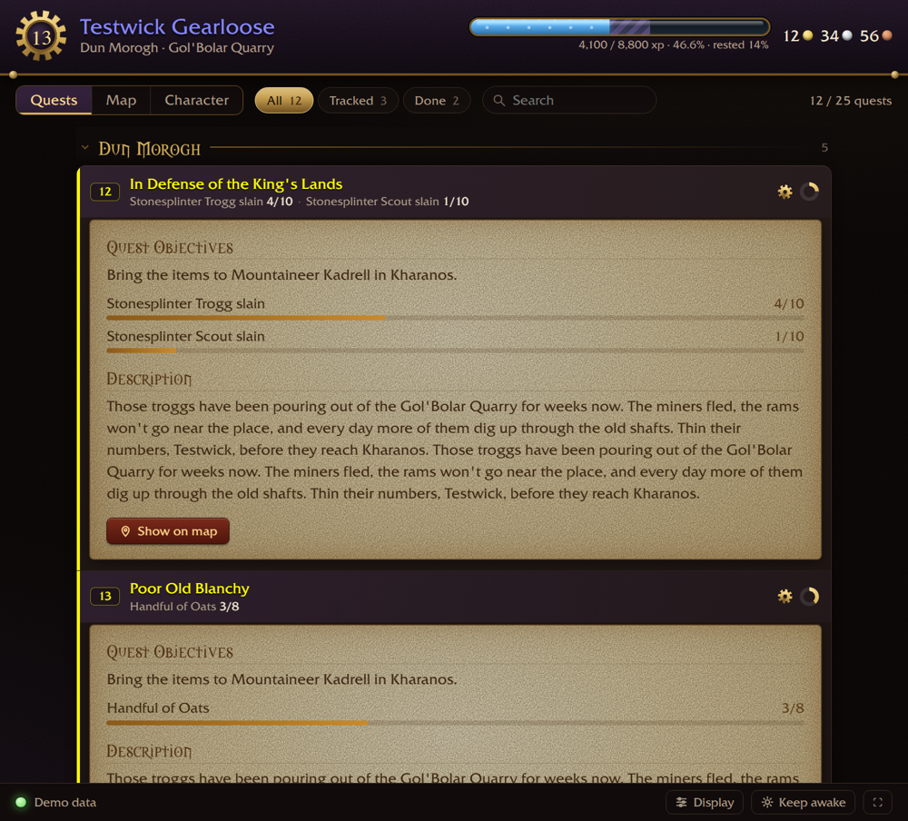
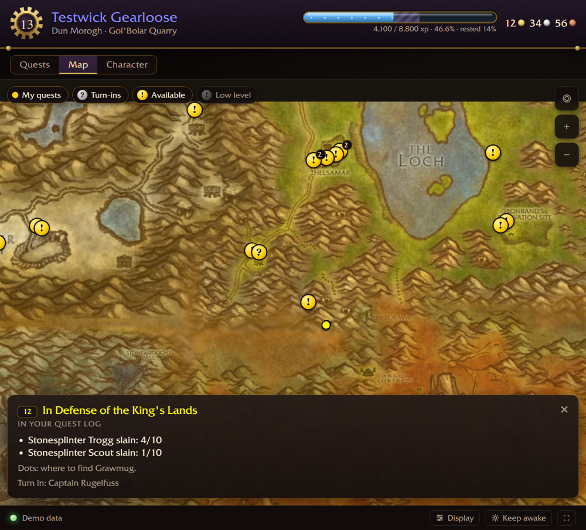
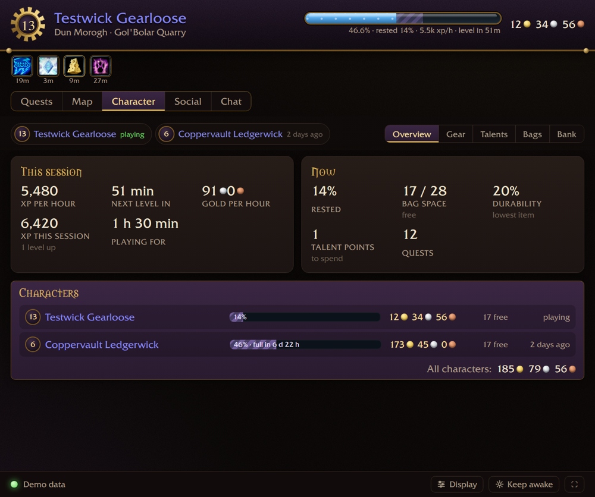
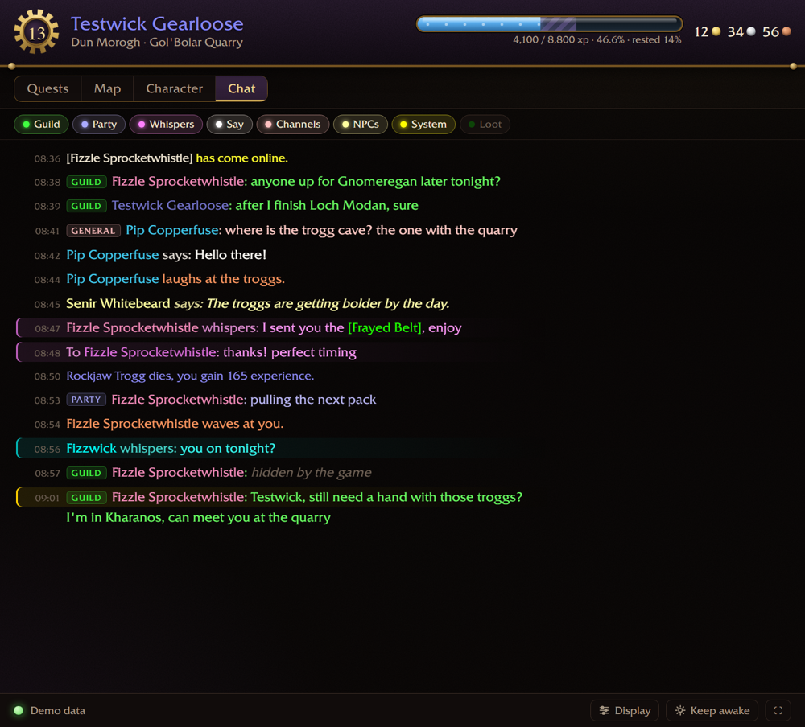
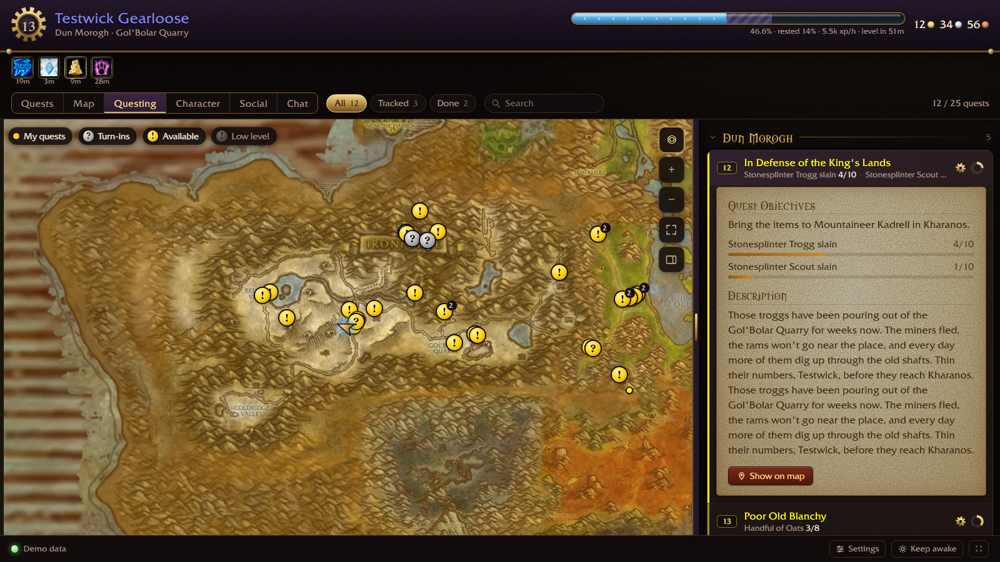

# Periscope

A second screen for **World of Warcraft Forever** on your phone or tablet: your quest log, a world map
with your quests on it, your character, bags and bank (alts too), talents, guild and friends,
chat, and alerts when a long buff runs out or Well Fed is missing.

| Map | Character | Chat |
|---|---|---|
|  |  |  |

On a tablet or an unfolded phone, **Questing** puts the map and your quest log side by side:

## How it works, and why it's safe

Periscope only looks; it never touches the game. The addon paints a thin strip of coloured blocks in
the bottom-left corner of your screen. The Periscope program on your PC reads those pixels the
way a screenshot would, and shows the page to your phone over your own Wi-Fi. Nothing is sent into
the game and the game's memory is never read. Your game data stays on your own network.

## Install

1. Download **Periscope-Setup-x.y.z.exe** from the [latest release](../../releases/latest).
2. Run it. Windows will warn that it's from an unknown publisher (the program isn't code-signed):
   click **More info → Run anyway**. It installs for your Windows user only and needs no admin rights.
3. Periscope starts at the end of the install. The first time, Windows Firewall asks about it:
   allow **Private networks**, so your phone can reach it.
4. Periscope puts its addon into WoW for you (`_forever_\Interface\AddOns\Periscope`). If WoW was
   running, restart it.

Would you rather not run an installer? The release also has a **.zip**: unzip it anywhere and
run `Periscope.exe`.

## Use

1. Start **Periscope** from the Start menu. A black window opens with an address and a QR code; leave
   it open while you play.
2. Log in to WoW. The strip appears in the bottom-left corner.
3. Scan the QR code with your phone (it must be on the same Wi-Fi as the PC). On the phone, use
   **Add to Home screen** to get it as an app.

On the map, **Rares** shows rare and rare elite mobs (silver badge with their level); tap one to
see what it drops of its own, like Vultros' Talon of Vultros, and tap an item (or hover it with a
mouse) for its tooltip. **Item quests** shows quests that start
from a dropped item, like the Nibbled-On Book from Northshire's kobolds, where those mobs are. The
**Lv** chip sets how many levels below and above yours to show.

On a bigger screen, try the **Questing** tab: the map with your quest log beside it. Tap a quest
to light it up on the map, or tap one of your quests on the map to find it in the log. The buttons
under the map's zoom go full screen and swap between side by side and map-on-top; drag the bar
between them to share the screen differently.

In game: `/peri` shows the status, `/peri off` and `/peri on` turn the strip off and on, and
`/peri chat skip <channel>` hides a chat channel from the phone (`/peri chat` lists them).

## If it doesn't connect

- **The window says "Waiting for the strip":** the strip must be visible. Play in
  *Windowed (Fullscreen)* or *Windowed* mode, and don't cover the bottom-left corner. Alt-tabbing
  to another window hides it, and Periscope picks it up again when you come back. With more than
  one monitor, Periscope looks on each in turn, which can take a few seconds.
- **HDR:** with Windows HDR on, low "SDR content brightness" makes the strip hard to read. Turn
  HDR off for the desktop, or raise that slider.
- **The phone can't open the page:** check that the phone is on the same Wi-Fi, and that
  Periscope is allowed through Windows Firewall on private networks (Windows Security → Firewall
  → Allow an app). Away from home: install [Tailscale](https://tailscale.com) on the PC and the
  phone, and Periscope shows a second address that works anywhere.
- **Port 8770 is taken:** another Periscope is already running. Close it.

The program keeps its own files (icons, the last state) in `%LOCALAPPDATA%\Periscope`.

## Feedback

Join the Discord: https://discord.gg/Eb3mpB5Zu2 (the #periscope channel).

## Credits

Made by xnik, with Claude (Anthropic) writing the code. The quest database comes from
[QuestieDB](https://github.com/Questie/QuestieDB) (GPL-3.0), and the world map art from OpenMap and
Blizzard Entertainment. See NOTICE.txt in the program folder. Periscope is not affiliated with or
endorsed by Blizzard Entertainment.
